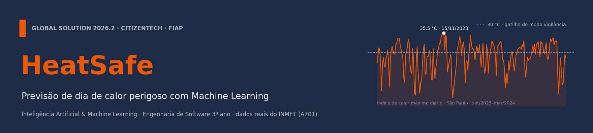
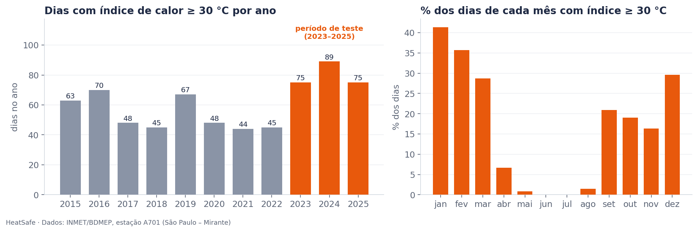
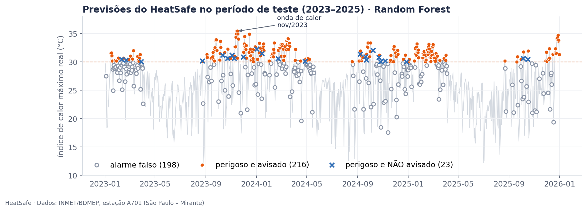
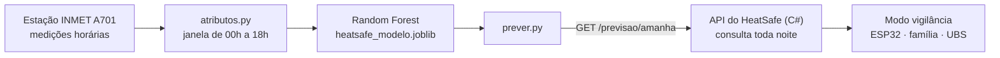

<div align="center">



# HeatSafe · Inteligência Artificial & Machine Learning

**Amanhã será um dia de calor perigoso? O modelo responde na véspera, às 19h, com dados reais do INMET.**

*Global Solution 2026.2 · CitizenTech · FIAP · Engenharia de Software, 3º ano*

[](https://youtu.be/fC9X_KEJjqw)
[](ml/heatsafe_previsao_dia_perigoso.ipynb)
[](ml/RELATORIO_ML.md)


</div>

---

## 📌 Visão geral

Nos dias de calor extremo, **idosos que passam o dia sozinhos em casas quentes podem passar mal sem perceber o risco, e ninguém fica sabendo a tempo.** O HeatSafe é uma solução com um dispositivo IoT dentro da casa, uma API, um app para a família e a UBS e, nesta disciplina, **um modelo de Machine Learning que prevê o perigo na véspera**.

> **A pergunta:** às 19h de hoje, com o que a estação já mediu, dá para saber se **amanhã** o índice de calor máximo vai chegar a **30 °C ou mais**?
>
> Se sim, o HeatSafe liga o **modo vigilância**: mais lembretes de água no dispositivo, e família e UBS avisadas antes.

<div align="center">

| 🎯 Dias perigosos avisados | 🔥 Dias mais extremos avisados | 🌡️ Onda de calor de nov/2023 | 📈 ROC-AUC (teste) |
|:---:|:---:|:---:|:---:|
| **90%**<br><sub>216 de 239</sub> | **98%**<br><sub>81 de 83 (≥ 32 °C)</sub> | **10 de 11**<br><sub>dias avisados na véspera</sub> | **0,917**<br><sub>validação: 0,921</sub> |

<sub>Resultados no período de teste (2023–2025), com dados que o modelo nunca viu.</sub>

</div>

## 👥 Equipe

| Integrante | RM |
|---|---|
| Felipe Braunstein e Silva | RM554483 |
| Felipe do Nascimento Fernandes | RM554598 |
| Henrique Ignacio Bartalo | RM555274 |
| Gustavo Henrique Martins | RM556956 |

## 📦 Entregáveis

| Entrega | Onde está |
|---|---|
| 🎬 Vídeo de apresentação (até 5 min) | [`youtu.be/fC9X_KEJjqw`](https://youtu.be/fC9X_KEJjqw) |
| 📓 Notebook executado, com todas as saídas | [`ml/heatsafe_previsao_dia_perigoso.ipynb`](ml/heatsafe_previsao_dia_perigoso.ipynb) |
| 📄 Relatório (do problema à conclusão) | [`ml/RELATORIO_ML.md`](ml/RELATORIO_ML.md) |
| 🗂️ Dados: fonte, link, período e tratamento | [`ml/dados/README.md`](ml/dados/README.md) |
| 📦 Dependências | [`ml/requirements.txt`](ml/requirements.txt) |
| 🤖 Registro do uso de IA | [`ml/prompts.md`](ml/prompts.md) |
| 🧾 Ficha da CitizenTech e detalhes de execução | [`ml/README.md`](ml/README.md) |

---

## 🧭 Como o modelo foi construído

| Etapa | O que fizemos | Por quê |
|---|---|---|
| **1. Dados** | 96.430 medições horárias **reais** do INMET (estação A701, Mirante de Santana), 2015–2025 → 4.018 dias | Dados públicos e auditáveis; nada simulado entra no treino |
| **2. Alvo** | Dia perigoso = índice de calor máximo ≥ 30 °C (fórmula da NOAA) | Mesmo critério do dispositivo e da API do HeatSafe |
| **3. Sem espiar o futuro** | 30 atributos calculados só com o que foi medido **até as 18h** | O modelo roda às 19h; usar dados de depois seria vazamento |
| **4. Divisão no tempo** | Treino 2015–2022 · teste 2023–2025, usado uma única vez no fim | Como na vida real: treina no passado, prevê um futuro que não viu |
| **5. Modelos** | XGBoost × Random Forest, **66 combinações** de hiperparâmetros com validação cruzada temporal (5 dobras) | O Random Forest generalizou melhor, e por isso **trocamos** o plano inicial |
| **6. Métrica** | Recall priorizado com **F2**; limiar de decisão ajustado (P ≥ 0,15) | Deixar passar um dia perigoso é o erro grave; alarme falso só incomoda |
| **7. Comparação honesta** | Contra regras simples, como "amanhã será como hoje" | O modelo perde menos dias perigosos, ordena melhor o risco e entrega uma **probabilidade** |

<div align="center">
  
  <br><sub>Os dias com índice de calor ≥ 30 °C passaram de 54 por ano (2015–2022) para 80 por ano (2023–2025).</sub>
</div>

## 📊 Resultados

<div align="center">
  
  <br><sub>Cada ponto é um dia de 2023 a 2025. Dos 23 dias perdidos, 21 ficaram no limite, entre 30,0 e 31,5 °C.</sub>
</div>

<br>

| Período | Recall | Precisão | F2 | ROC-AUC |
|---|:---:|:---:|:---:|:---:|
| Treino (2015–2022) | 0,988 | 0,527 | 0,841 | 0,983 |
| Validação (fora da dobra) | 0,894 | 0,409 | 0,723 | 0,921 |
| **Teste (2023–2025)** | **0,904** | **0,522** | **0,788** | **0,917** |

A probabilidade vira **dois níveis de alerta**, como a família pediu (*"só ser avisada quando for sério"*):

| Nível | Probabilidade | O que acontece |
|---|:---:|---|
| 🟡 Vigilância silenciosa | P ≥ 0,15 | O dispositivo reforça os lembretes de água e a UBS reorganiza as visitas |
| 🔴 Família avisada na véspera | P ≥ 0,50 | 79% desses avisos se confirmam (cerca de 56 avisos por ano) |

---

## 🔗 Como esta parte conversa com o resto do HeatSafe



```bash
python prever.py --data 2023-11-12
# {"data": "2023-11-13", "perigoso": true, "probabilidade": 0.83}
```

O modelo responde no mesmo formato do contrato da API. Os dados do dispositivo dentro da casa são simulados no protótipo e **não** entram no treino.

## ▶️ Como executar

```bash
cd ml
python -m venv .venv
# Windows: .venv\Scripts\activate    ·    Linux/macOS: source .venv/bin/activate
pip install -r requirements.txt

# 1) (opcional) regenerar os CSVs limpos a partir dos arquivos brutos do INMET
cd dados && python preparar_dados.py && cd ..

# 2) executar o notebook inteiro (~3 min)
jupyter nbconvert --to notebook --execute --inplace heatsafe_previsao_dia_perigoso.ipynb

# 3) usar o modelo treinado
python prever.py --data 2023-11-12
```

## 🌍 Impacto

| ODS | Como o HeatSafe contribui |
|---|---|
| **3** · Saúde e bem-estar | Alerta precoce de riscos à saúde (meta 3.d) |
| **13** · Ação contra a mudança do clima | Adaptação a um clima que já mudou: de 54 para 80 dias perigosos por ano (meta 13.1) |
| **11** · Cidades sustentáveis | Comunidades mais resilientes ao calor |
| **10** · Redução das desigualdades | Protege quem menos usa tecnologia |

**Próximos passos:** usar estações vizinhas do INMET para enxergar frentes frias e ondas de calor chegando · calibrar o limiar de 30 °C com os sensores instalados dentro das casas · retreinar todo ano, porque o clima mudou dentro dos próprios dados.

## 📁 Estrutura do repositório

```
├── README.md                                  ← este arquivo
└── ml/
    ├── README.md                              ← ficha da CitizenTech e detalhes
    ├── RELATORIO_ML.md                        ← relatório
    ├── heatsafe_previsao_dia_perigoso.ipynb   ← notebook executado
    ├── atributos.py                           ← atributos (mesmo código no treino e em produção)
    ├── prever.py                              ← previsão no formato do contrato da API
    ├── requirements.txt
    ├── prompts.md                             ← registro do uso de IA
    ├── ROTEIRO_VIDEO.md                       ← roteiro do vídeo
    ├── dados/                                 ← dados do INMET (brutos e limpos)
    ├── figuras/                               ← gráficos gerados pelo notebook
    └── modelo/                                ← modelo treinado, metadados e grades testadas
```

<div align="center">
<sub>HeatSafe · Global Solution CitizenTech 2026.2 · FIAP · Engenharia de Software</sub>
</div>
