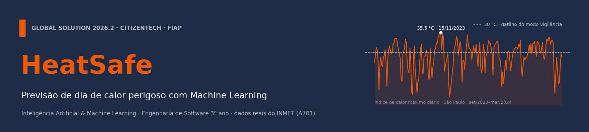

# HeatSafe · Inteligência Artificial & Machine Learning

> **Amanhã será um dia de calor perigoso?** Modelo que responde a essa pergunta na véspera, às 19h, com dados reais do INMET, e liga o **modo vigilância** do HeatSafe para proteger idosos que passam o dia sozinhos em casas quentes.

**Global Solution 2026.2 · CitizenTech** · FIAP · Engenharia de Software · 3º ano (Fev)

| Integrante | RM |
|---|---|
| Felipe Braunstein e Silva | RM554483 |
| Felipe do Nascimento Fernandes | RM554598 |
| Henrique Ignacio Bartalo | RM555274 |
| Gustavo Henrique Martins | RM556956 |

**Entregas desta disciplina:**
📓 [Notebook executado](heatsafe_previsao_dia_perigoso.ipynb) · 📄 [Relatório (RELATORIO_ML.md)](RELATORIO_ML.md) · 🗂️ [Dados (dados/README.md)](dados/README.md) · 🎬 [Vídeo no YouTube](https://youtu.be/fC9X_KEJjqw)

---

## Ficha da CitizenTech

| Campo | Resposta |
|---|---|
| **Nome** | HeatSafe |
| **Cidade e bairro** | São Paulo, casas térreas com telha de fibrocimento na zona leste |
| **Cidadão beneficiado** | Idosos que moram ou passam o dia sozinhos em casas quentes; também familiares e agentes comunitários de saúde da UBS |
| **Problema, em uma frase** | Nos dias de calor extremo, idosos que passam o dia sozinhos em casas quentes podem passar mal sem perceber o risco, e ninguém fica sabendo a tempo. |
| **Como funciona** | Um dispositivo com ESP32 dentro da casa mede o calor e detecta movimento. Se a casa está perigosa e o idoso fica parado ou sem beber água, a família é avisada; sem resposta, o caso vai para a lista de visitas da UBS. **Um modelo de ML prevê os dias perigosos na véspera** (esta pasta). |
| **O que esta parte faz** | Prevê às 19h se amanhã o índice de calor máximo vai chegar a 30 °C, e liga o modo vigilância |
| **Indicador de impacto (ML)** | % de dias perigosos avisados na véspera (**90% no teste**) · % dos avisos que se confirmam · alarmes falsos por ano |
| **ODS conectados** | 3 (meta 3.d) · 13 (meta 13.1) · 11 · 10 |

## Resultados em uma tabela

| Teste 2023–2025 (dados que o modelo nunca viu) | |
|---|---|
| Dias perigosos avisados na véspera | **216 de 239 (90%)** |
| Dias mais extremos (≥ 32 °C) avisados | **81 de 83 (98%)** |
| Onda de calor de nov/2023 | **10 de 11 dias** avisados |
| Avisos que se confirmam | 52% (79% quando P ≥ 0,50) |
| ROC-AUC na validação cruzada × teste | 0,921 × 0,917 (a estimativa foi honesta) |
| Modelo | **Random Forest**, escolhido contra o XGBoost por validação cruzada temporal (66 combinações de hiperparâmetros) |

## Como executar

```bash
cd ml
python -m venv .venv
# Windows: .venv\Scripts\activate    ·    Linux/macOS: source .venv/bin/activate
pip install -r requirements.txt

# 1) (opcional) regenerar os CSVs limpos a partir dos arquivos brutos do INMET
cd dados && python preparar_dados.py && cd ..

# 2) executar o notebook inteiro (~3 min)
jupyter nbconvert --to notebook --execute --inplace heatsafe_previsao_dia_perigoso.ipynb
#    ou abrir no Jupyter / VS Code e usar "Run All"

# 3) usar o modelo treinado (formato do contrato GET /previsao/amanha)
python prever.py --data 2023-11-12
# {"data": "2023-11-13", "perigoso": true, "probabilidade": 0.83}
```

## Estrutura

```
ml/
├── README.md                                # este arquivo
├── RELATORIO_ML.md                          # relatório (do problema à conclusão)
├── heatsafe_previsao_dia_perigoso.ipynb     # notebook executado, com todas as saídas
├── atributos.py                             # engenharia de atributos (mesmo código no treino e em produção)
├── prever.py                                # previsão no formato do contrato da API (usado pelo serviço de SOA)
├── requirements.txt
├── prompts.md                               # registro do uso de IA como copiloto
├── ROTEIRO_VIDEO.md                         # roteiro do vídeo de até 5 min
├── dados/
│   ├── README.md                            # fonte, link, período, tratamento e colunas
│   ├── brutos/                              # 11 CSVs originais do INMET (2015–2025), sem alteração
│   ├── inmet_a701_horario_2015_2025.csv     # 96.430 horas limpas (entrada do modelo)
│   ├── inmet_a701_diario_2015_2025.csv      # 4.018 dias (alvo e análise exploratória)
│   └── preparar_dados.py
├── figuras/                                 # gráficos gerados pelo notebook
└── modelo/
    ├── heatsafe_modelo.joblib               # Random Forest de produção (treinado em 2015–2025)
    ├── metadados.json                       # atributos, limiares, hiperparâmetros, métricas
    ├── grade_xgboost.csv                    # as 36 combinações testadas
    └── grade_random_forest.csv              # as 30 combinações testadas
```

## Como esta parte conversa com o resto do HeatSafe

```
[INMET A701] → dados/ → notebook → modelo/heatsafe_modelo.joblib
                                          │
                     prever.py ◄──────────┘
                         │  (importado pelo serviço FastAPI · disciplina de SOA)
                         ▼
        GET /previsao/amanha?estacao=A701 → {"data": "2026-01-01", "perigoso": true, "probabilidade": 0.53}
                         │  (consultado toda noite pela API C#)
                         ▼
        modo vigilância: lembretes de água no ESP32 · aviso à família · lista de visitas da UBS
```

O modelo usa só dados **reais e públicos** do INMET. Os dados do dispositivo dentro da casa são simulados no protótipo e **não** entram no treino.
