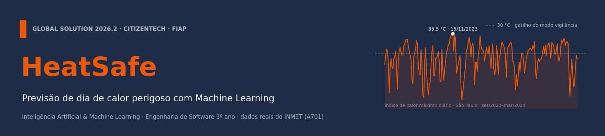
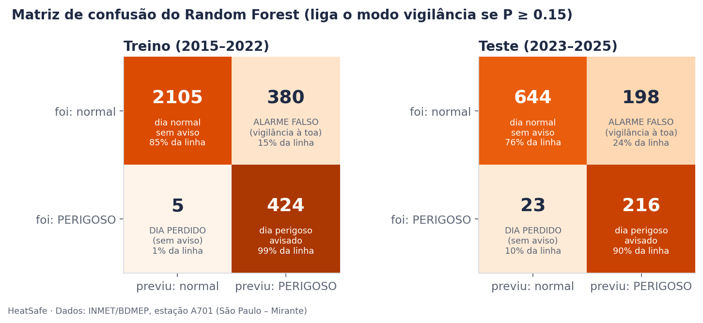
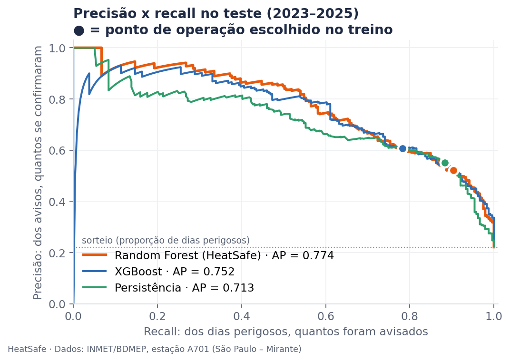
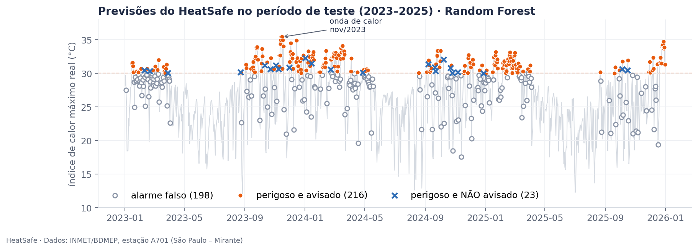

# Relatório de Machine Learning · HeatSafe

**GS 2026.2 · CitizenTech · IA & Machine Learning** · FIAP, Engenharia de Software, 3º ano (Fev)
**Integrantes:** Felipe Braunstein e Silva (RM554483) · Felipe do Nascimento Fernandes (RM554598) · Henrique Ignacio Bartalo (RM555274) · Gustavo Henrique Martins (RM556956)
**Notebook executado:** [`heatsafe_previsao_dia_perigoso.ipynb`](heatsafe_previsao_dia_perigoso.ipynb) · **Dados:** [`dados/README.md`](dados/README.md)

## 1. Problema e pergunta de ML

O **HeatSafe** é um dispositivo na casa de idosos que passam o dia sozinhos: ele mede o calor da casa, percebe se a pessoa se movimenta e avisa a família ou a UBS. A parte de ML dá **um dia de antecedência**: às 19h, o modelo diz se amanhã será perigoso e, se for, liga o **modo vigilância** (mais lembretes de água, família e UBS avisadas antes).

> **Pergunta (classificação binária):** às 19h de hoje, com o que a estação já mediu, dá para saber se **amanhã o índice de calor máximo em São Paulo vai chegar a 30 °C ou mais?**

O pior erro é **deixar passar um dia perigoso**, porque a Dona Maria (persona do projeto, 78 anos, que *"não sente sede"*) fica desprotegida. O alarme falso custa pouco, porque o alerta à família só dispara se o sensor **dentro da casa** confirmar o perigo. Por isso otimizamos o **F2** (recall com peso 2), sem ignorar a precisão: a filha avisou que *"se o celular apitar toda hora, vou acabar ignorando"*.

## 2. Dados reais e públicos

**INMET · BDMEP** ([portal.inmet.gov.br/dadoshistoricos](https://portal.inmet.gov.br/dadoshistoricos), baixado em 08/11/2026), estação **A701, São Paulo (Mirante de Santana)**, de **01/01/2015 a 31/12/2025**: **96.430 medições horárias**. O tratamento (`dados/preparar_dados.py`) troca `-9999` por vazio (0,4% das horas), converte UTC para o horário de Brasília e calcula o **índice de calor da NOAA** (a mesma fórmula do ESP32). Os dados mostram a tendência: média de **54 dias ≥ 30 °C por ano em 2015–2022** contra **80 em 2023–2025**.

## 3. Preparação e divisão treino/teste

- **Sem espiar o futuro:** o modelo roda às 19h, então os atributos do dia D usam **só as medições de 00h a 18h**. O alvo é o índice máximo do **dia D+1 inteiro**.
- **30 atributos** (`atributos.py`, o mesmo código usado em produção): calor, umidade, ponto de orvalho, pressão, radiação, chuva e vento de D; valores de D-1 e D-2; médias de 3 e 7 dias; variação de ontem para hoje; época do ano. Os faltantes são preenchidos com a mediana **do treino**, dentro do *pipeline*.
- **Divisão temporal:** treino com os dias de **2015–2022** (2.914 dias, 14,7% perigosos) e teste com **2023–2025** (1.081 dias, 22,1% perigosos), usado **uma única vez**. As escolhas saíram de uma **validação cruzada temporal** (`TimeSeriesSplit`, 5 dobras) só no treino.
- **Por que 30 °C e não 32 °C:** com 32 °C sobram só 86 dias positivos no treino, e nenhum modelo superou a regra "amanhã será como hoje" (AP de 0,30 contra 0,31). Com 30 °C os modelos passam a superá-la (0,65 contra 0,60). Além disso, a estação é ventilada e mede menos calor do que uma casa de fibrocimento, então 30 °C funciona como gatilho com margem de segurança.

## 4. Escolha do modelo

A tabela é pequena (≈ 2.900 dias) e as relações não são lineares. Por isso comparamos dois comitês de árvores: o **XGBoost** (boosting: árvores em sequência, com baixo viés e risco de decorar) e o **Random Forest** (bagging: média de árvores independentes, com baixa variância e estável com rótulos "no limite", como 29,9 × 30,1 °C). Descartamos **LSTM** (pouco dado, e a memória já entra nos atributos D-1, D-2 e nas médias), **KMeans + PCA** (é não supervisionado, e temos o rótulo) e **MLP** (sensível e pouco interpretável com poucos positivos). As **linhas de base** são "nunca avisar" (78% de acurácia e recall zero, por isso não usamos a acurácia) e a **persistência**: "se hoje passou de 28,6 °C, amanhã também passa", com o limiar ajustado no treino.

## 5. Treino com diferentes hiperparâmetros

| Modelo | 3 hiperparâmetros | Combinações | AP validação (pior → melhor) | Melhor |
|---|---|---|---|---|
| XGBoost | `max_depth` {1–4} · `learning_rate` {0,01; 0,03; 0,1} · `n_estimators` {100, 300, 600} | **36** | 0,557 → 0,645 | depth 2, lr 0,03, 100 árvores |
| Random Forest | `max_depth` {4, 6, 8, 12, ∞} · `min_samples_leaf` {1, 5, 20} · `max_features` {√, 50%} | **30** | 0,640 → **0,668** | depth 8, folha 5, √ |

Foram 330 treinos no total (cada combinação nas 5 dobras), escolhidos pelo **Average Precision**, adequado a classes desbalanceadas. O **Random Forest venceu**: AP maior, melhor em 3 de 5 dobras e com probabilidades mais confiáveis (Brier 0,070 × 0,072). Era o XGBoost no plano inicial; **trocamos porque os dados mostraram que o Random Forest generaliza melhor.** Dar peso extra à classe rara piorou as probabilidades (Brier de 0,070 para 0,083), então tratamos o desbalanceamento pelo **limiar de decisão**: o maior F2 fora da dobra levou a **P ≥ 0,15**.

## 6. Resultados em treino e teste

| Random Forest | Recall | Precisão | F2 | AP | ROC-AUC | Brier |
|---|---|---|---|---|---|---|
| Treino (2015–2022) | 0,988 | 0,527 | 0,841 | 0,923 | 0,983 | 0,042 |
| Validação cruzada (fora da dobra) | 0,894 | 0,409 | 0,723 | 0,654 | 0,921 | 0,070 |
| **Teste (2023–2025)** | **0,904** | **0,522** | **0,788** | **0,774** | **0,917** | **0,095** |

**Overfitting:** o Random Forest quase decora o treino (recall de 99%), porque cada árvore já viu esses dias. Por isso a estimativa honesta vem da validação cruzada, e ela acertou: o **ROC-AUC, que não depende da proporção de positivos, foi 0,921 na validação e 0,917 no teste**. O AP e a precisão subiram no teste porque 2023–2025 teve mais dias perigosos (22% contra 15%), não porque o modelo melhorou. A busca conteve o overfitting com folhas de no mínimo 5 dias e profundidade 8.

| Teste: 239 dias perigosos | Recall | Precisão | F2 | AP | Perdidos | Alarmes falsos |
|---|---|---|---|---|---|---|
| Nunca avisar | 0,000 | — | 0,000 | 0,221 | 239 | 0 |
| Persistência (hoje ≥ 28,6 °C) | 0,883 | 0,551 | 0,788 | 0,713 | 28 | 172 |
| XGBoost | 0,782 | 0,607 | 0,740 | 0,752 | 52 | 121 |
| **Random Forest (HeatSafe)** | **0,904** | 0,522 | **0,788** | **0,774** | **23** | 198 |

**Leitura honesta:** a persistência é forte, porque o calor de hoje é o principal sinal do calor de amanhã. O Random Forest **ordena melhor** o risco (maior AP e ROC-AUC), perde 5 dias perigosos a menos, com 26 alarmes falsos a mais em 3 anos, e entrega uma **probabilidade calibrada** (Brier 0,095, contra 0,178 da referência) que a regra simples não oferece. Dos 23 dias perdidos, 21 ficaram entre 30,0 e 31,5 °C; dos **83 dias mais extremos (≥ 32 °C), avisou 81 (98%)**. Os alarmes falsos foram dias quentes (mediana de 28,1 °C), não frios.

## 7. Conclusão para o cidadão

- **Dona Maria:** em **9 de cada 10 dias de calor perigoso**, o HeatSafe entra em vigilância na véspera. Na onda de calor de novembro de 2023 (recorde de 35,5 °C), **10 de 11 dias** foram avisados.
- **Ana (filha):** a probabilidade permite **dois níveis**. Com P ≥ 0,15, a vigilância é silenciosa (só o dispositivo e a UBS). Com **P ≥ 0,50**, a família é avisada, e **79% desses avisos se confirmam**. É o *"só ser avisada quando for sério"* que ela pediu.
- **Rosa (UBS):** às 19h da véspera, a unidade já pode reorganizar as visitas.

**Limitações e próximos passos:** uma única estação não enxerga a frente fria ou o ar quente que chegam de fora, então o próximo passo é usar estações vizinhas do INMET. O limiar de 30 °C deve ser calibrado com os dados dos próprios dispositivos dentro das casas. O clima mudou dentro dos dados (o modelo previu 19% de dias perigosos contra 22% reais), por isso o **modelo de produção é retreinado com 2015–2025** (`modelo/heatsafe_modelo.joblib`, servido por `prever.py`) e deve ser retreinado todo ano.

**ODS:** **3** (meta 3.d, alerta precoce) · **13** (meta 13.1, adaptação: de 54 para 80 dias perigosos por ano) · **11** (cidades resilientes) · **10** (protege quem menos usa tecnologia).
